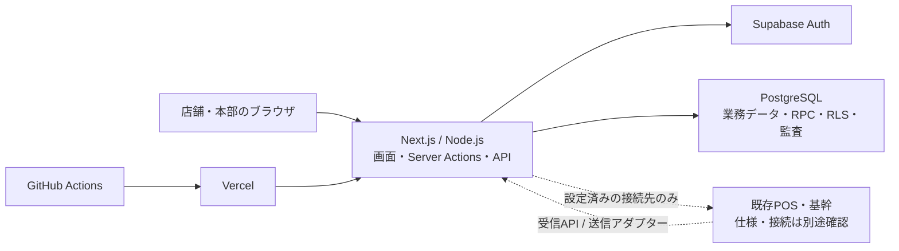
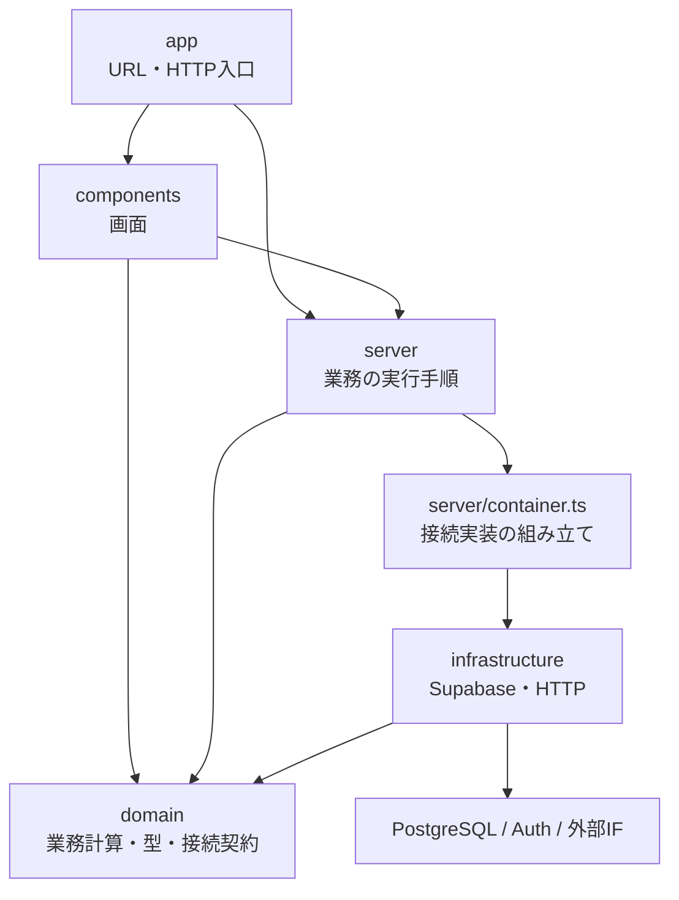
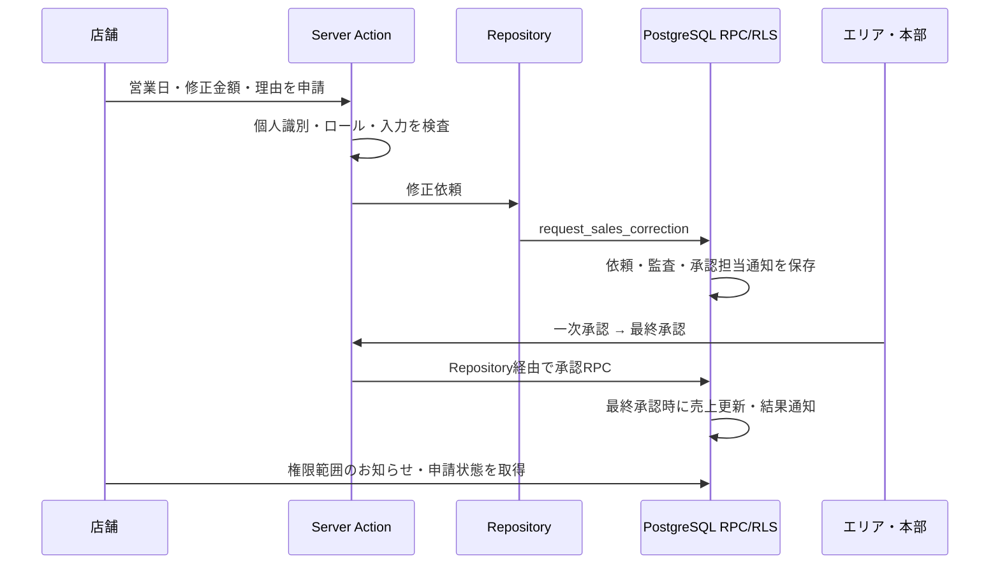

# アーキテクチャ

このシステムは **Next.jsを中心とした階層型モノリス** です。一つのWebアプリの中で、画面、サーバー処理、業務ルール、外部接続をフォルダーで分離します。初期基盤はNext.js App Router / TypeScript / Node.js 22、Supabase PostgreSQL・Auth、Vercelです。Pythonは要件書の検査だけに使用します。

業務要件は[統合要件書v3](../みのり屋_販売管理システム_統合要件書_v3.md)の第25章と明示された追加指示、技術基盤は[ADR-0001](./adr/0001-platform.md)、コード配置は[ADR-0002](./adr/0002-code-organization.md)を基準にします。

## 全体構成

図の外部接続は実装された接続口を表します。ベンダーIFの合意や本番接続完了を示すものではありません。既存POS・基幹の全面置換は行いません。

## コードの役割

| 場所 | 責務 | 主な入口 |
|---|---|---|
| `src/app/` | URL、ページの組み立て、HTTP要求・応答、Next.js固有の設定 | `page.tsx`、`layout.tsx`、`route.ts` |
| `src/components/` | 画面表示、入力、操作フィードバック。機能別に配置 | `store/`、`campaigns/`、`notifications/` |
| `src/domain/` | 外部接続に依存しない業務計算、認可表、データ型・接続契約 | `sales.ts`、`access-policy.ts`、`contracts.ts` |
| `src/server/` | Server Actions、セッション確認、入力検証、取得・取込・連携手順 | `actions/`、`queries/`、`auth/` |
| `src/infrastructure/` | SupabaseやHTTPの具体的な接続実装 | `supabase/`、`integrations/` |
| `src/config/` | 画面名、ルート定義、テーマ、表示設定 | `ui.ts` |
| `src/mocks/` | 架空のプレビューデータとデモ用状態遷移 | `workspaces.ts`、`corrections.ts` |
| `supabase/` | テーブル、RPC、RLS、トリガー、ローカル用seed | `migrations/`、`seed.sql` |
| `tests/` | DB統合、構成境界、要件トレーサビリティ検査 | `architecture.test.ts`、`database-schema.test.ts` |

UIのServer Componentは取得処理を呼び、Client Componentは入力やローカル状態を扱います。Client Componentからサーバー処理を呼ぶ入口は `server/actions/` の `"use server"` モジュールです。

## 依存関係

- `domain` はNext.js、React、Supabase、HTTP実装に依存しません。
- `infrastructure` は業務契約と同じ接続層を参照し、画面やServer Actionsを参照しません。
- 接続実装の選択は `server/container.ts` に集めます。通常のサーバー処理やAPIルートはこの組み立て口を利用します。
- 画面の定数・テーマは `config/ui.ts` に集約します。認証の成立や金額の変更可否を表示設定では判定しません。
- 通常のサーバー処理は `mocks` を読みません。架空データは明示されたプレビュー画面と既存の `/api/mock` に限定します。
- Next.jsのProxy入口はセッション更新用の接続実装を呼びます。ブラウザ用Supabaseクライアントは専用ファイルに分離し、公開可能な設定だけを扱います。

`tests/architecture.test.ts` が上記の主要な依存境界と旧 `lib` 参照の残存を検査します。型と接続契約はコンパイルで、実際の認可と業務条件はDBテストで検査します。

## データと認可の責任

重要な承認・締め・価格・監査のルールは、現在の実装ではPostgreSQLのRPC、RLS、制約、トリガーにも存在します。TypeScriptの `domain` だけに全ルールを移した構成ではありません。複数テーブルの整合と店舗・エリア・担当売場の境界はDB側でも強制します。

通常の画面操作は個人セッションの権限で実行します。管理用クライアントは利用者登録や信頼された連携処理などの限定経路に分け、`service_role`・DBパスワードをブラウザへ渡しません。店舗端末の閲覧と重要操作の個人識別は別の経路です。[セキュリティ運用](./security-operations.md)も参照してください。

## 主要な処理の流れ

### 店舗からの売上修正

翌日以降はエリア一次承認と店舗運営本部最終承認を維持し、最終承認までは元売上を変更しません。月次確定後は変更不可です。

### 本部からの特売・価格変更指示

商品本部の入力 → Server Actionの検証 → Repository → RPCで指示・対象店舗・お知らせ・監査を同時保存 → 指定店舗が受領確認、という流れです。受領確認、値札等の売場作業、POS反映は別の状態です。[指示・通知の詳細](./store-instructions.md)を参照してください。

### 外部連携

受信は `/api/integrations/ingest` で専用認証と形式を検査し、DBの受信処理へ渡します。送信は `/api/integrations/run` → `server/integrations/run.ts` → ワーカー → HTTPアダプターです。DBのジョブ記録・リース・冪等キーを用いて、失敗と再処理を管理します。接続先の設定がない処理を成功として表示しません。

## 変更時の参照先

具体的なファイルと要件・テストの対応は[コード案内](./code-map.md)、画面URLは[ルート設計](./routes.md)、検証方法は[テスト方針](./testing.md)、配備手順は[CI/CD](./ci-cd.md)、DB変更は[マイグレーション方針](./data-migrations.md)を参照してください。

## 実装済みと未検証の境界

画面、Server Actions、接続アダプター、SQLマイグレーション、ローカル検証コードが存在します。DB未設定時は架空データの操作プレビューを表示します。実環境へのマイグレーション適用、実アカウントでの認証E2E、POS・基幹の物理IF、本番負荷・復旧試験は別途確認が必要です。SLA、保存期間、RTO/RPOの候補値を確定条件にしません。

今回の構成整理では業務ルール・DBスキーマ・URL・技術基盤を維持します。検証時に見つかった特売検証SQLの関数区切り文字の欠落は補完しました。未決の業務判断は[未決事項一覧](./open-questions.md)、受入状況は[v3照合台帳](./requirements-v3-audit.md)で管理します。
