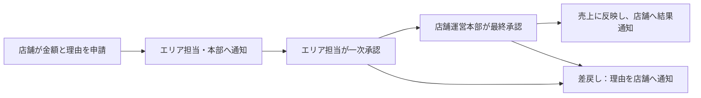
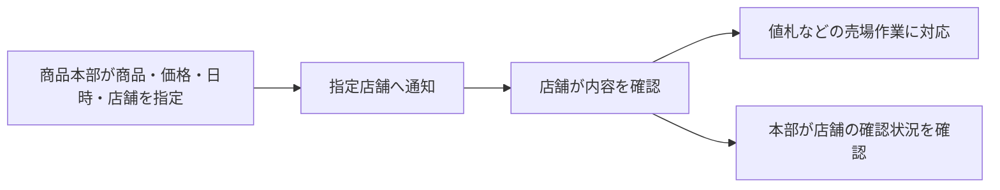

# はじめて読む方へ：機能とフォルダーの案内

このシステムは、店舗と本部が「売上の確認」「修正の依頼・承認」「特売や価格変更の指示」を同じ場所で扱うためのものです。この資料は、プログラミングの知識がなくても、何のための機能か、どこに何が置かれているかを把握できるようにまとめています。

## 1. 誰が、何に使うのか

店舗では、自店の状況を確認し、本部から届いた指示に対応します。本部では、店舗全体の状況を確認し、修正依頼の承認や特売・価格変更の指示を行います。

表示される機能と操作できる範囲は、その人の担当と権限によって変わります。共用PCで自店の情報を見ることと、個人として金額変更や承認を行うことは、別の扱いです。

### 店舗で使う画面

| 画面         | 何のために使うか                                     | 具体例                                                 |
| ------------ | ---------------------------------------------------- | ------------------------------------------------------ |
| 店舗ポータル | 自店の状況を最初に確認する                           | 売上・客数・客単価を数字やグラフで見る                 |
| 売上         | 営業日ごとの売上、修正申請、申請状況を確認する       | 昨日の売上や修正申請の進み具合を確認する               |
| 在庫         | 届いている在庫情報を品目・種別・業者で調べる         | 商品の在庫を確認し、必要に応じて発注画面へ進む         |
| 発注         | 商品・数量・希望納期を入力し、その後の状態を確認する | 商品を何個、いつまでに必要か登録する                   |
| 特売・価格   | 本部の特売内容や価格変更の指示、店舗作業を確認する   | 指定商品・価格・日時を確認し、値札などの対応を記録する |
| お知らせ     | 本部からの指示や、申請した修正の結果を確認する       | 新しい指示、修正の承認・差戻しを読む                   |

店舗機能はサイドバーから直接開きます。「店舗用共通メニュー」を経由する必要はありません。

### 本部・管理担当者が使う画面

| 画面             | 何のために使うか                                                 |
| ---------------- | ---------------------------------------------------------------- |
| 売上管理         | 店舗ごとの売上を集計・比較する                                   |
| 商品管理         | 商品情報を検索・管理し、通常売価などの参照情報を確認する         |
| 特売管理         | 特売を作成・公開し、指定店舗へ作業や価格変更の指示を送る         |
| 発注管理         | 店舗からの発注内容と処理状況を確認する                           |
| 申請・承認       | 店舗から届いた売上修正依頼の内容を確認し、承認または差戻しを行う |
| 月次・会計       | 月単位の売上の確定を扱う。会計への出力・接続は別途確認が必要     |
| 店舗・端末管理   | 店舗の基本設定や、その店舗で使うPCの登録を扱う                   |
| 連携監視         | データの取込・送信状況やエラーを確認し、対応する                 |
| 利用者・権限管理 | 利用者と、その人が担当する店舗・売場・操作範囲を設定する         |
| 監査ログ         | 誰が、いつ、何を変更したかを調べる                               |

たとえば、商品本部は特売・価格変更指示、店舗運営本部は売上修正の最終承認、情報システム担当は利用者や端末の管理を担当します。本部の機能を開けることと、すべての操作を実行できることも、それぞれ別の権限です。

## 2. 店舗と本部をつなぐ二つの流れ

### 店舗が後日の売上修正を依頼する場合

店長が対象の営業日、修正後の金額、修正理由を入力します。エリア担当が一次承認し、店舗運営本部が最終承認します。最終承認までは元の売上を維持し、差戻しになった場合は理由を店舗へ知らせます。

この流れは「翌日以降の修正」の説明です。当日の修正には別のルールがあり、月次確定後の売上はこのシステムでは修正できません。

### 本部が特売・価格変更を指示する場合

本部は、どの商品を、いくらで、いつから、どの店舗で扱うかを指定し、作業内容を添えて送ります。対象店舗に通知が届き、本部は店舗が内容を確認したかを確認できます。

「通知を送った」「店舗が指示を確認した」「値札などの作業を終えた」「レジの価格が変わった」は、それぞれ別の段階です。レジへの価格反映には、POSというレジ側システムとの接続が必要です。

### お知らせを読むときのポイント

通知を「既読」にする操作は、内容を読んだという記録です。売上修正の承認は、依頼を開いて内容を確認したうえで実行します。通知はシステム内のお知らせで、画面を開き直すなどして確認します。メールやスマートフォンへの通知とは別の機能です。

## 3. 今、試せることと、接続後に確認すること

各画面には担当する仕事がありますが、画面があることだけで、その仕事のすべてが実運用できる状態とは限りません。

| 状態                                | どう理解すればよいか                                                                                     |
| ----------------------------------- | -------------------------------------------------------------------------------------------------------- |
| サンプル・プレビューの表示          | 架空の店舗・商品・金額で、検索、入力、申請・通知などの操作を試す画面。実際の売上やレジ価格には影響しない |
| データ保存先と認証を接続した状態    | 登録済みの利用者・店舗情報を使い、担当範囲に沿ってデータを表示・保存する。接続設定と実環境での確認が必要 |
| POS・既存基幹システムと接続した状態 | レジの売上、在庫、発注結果などを外部システムと受け渡す。相手側の仕様と接続の確認が必要                   |

本部指示・売上修正依頼・通知の画面と保存処理は用意されています。実環境のデータ保存先への適用、実アカウントでの操作、POS・基幹との接続は別途確認が必要です。返品の詳細や会計出力など、画面の枠が先に用意されている部分もあります。

未接続のプレビューでは、同じブラウザのタブで「売上で修正依頼 → 本部の申請・承認 → 店舗のお知らせで結果確認」を試せます。本部の特売・価格変更指示も、発行後に店舗のお知らせで対象店舗を切り替えて確認できます。入力には架空の内容を使います。

## 4. フォルダーは何を分けているのか

「ディレクトリ」は、ファイルを入れるフォルダーのことです。このプロジェクトでは、役割ごとに置き場所を分けています。

たとえば、売上修正の申請では「入力画面を見せる」「申請内容と権限を確認する」「依頼を保存する」「担当者へ知らせる」という複数の仕事が発生します。それぞれの担当を探しやすくするために、ファイルを分けています。

### プログラムの主な置き場所

| フォルダー            | やさしく言うと                         | 主に入っているもの                                     |
| --------------------- | -------------------------------------- | ------------------------------------------------------ |
| `src/`                | システム本体のプログラム置き場         | 下記の画面・処理・設定一式                             |
| `src/app/`            | 画面や受付窓口の入口                   | どのアドレスで、どの画面・処理を開くか                 |
| `src/components/`     | 利用者に見せる画面と操作部品           | 表、グラフ、入力欄、ボタン、通知カード                 |
| `src/domain/`         | 業務上の計算や決まりの一部             | 営業日・税・集計の計算、担当権限の対応表、データの定義 |
| `src/server/`         | 画面の裏で仕事を進める担当             | 利用者確認、データ取得、申請・承認の受付、取込の手順   |
| `src/infrastructure/` | データ保存先や外部システムとの接続担当 | 保存先への読み書き、認証サービスや外部システムとの通信 |
| `src/config/`         | 共通の表示設定                         | 画面名、メニュー、色や文字の見た目                     |
| `src/mocks/`          | 操作練習用の架空データ                 | デモ店舗・商品・金額、プレビュー内の状態変化           |

画面はさらに、`components/store/` が店舗の表示、`campaigns/` が特売・価格指示、`notifications/` がお知らせ、`auth/` がログイン、`layout/` がサイドバーなどの共通枠、という分け方です。`preview/` は操作例、`legacy/` は互換用に残している旧画面です。

### `server` の中の分け方

| 置き場所        | 担当する仕事                                                 |
| --------------- | ------------------------------------------------------------ |
| `actions/`      | 「保存する」「申請する」「承認する」といった操作を受け付ける |
| `auth/`         | 誰が操作しているか、どの店舗を担当するかを確認する           |
| `queries/`      | 一覧や詳細の表示に必要な情報を集める                         |
| `imports/`      | CSVなどのファイルを読み取り、取り込む内容を確認する          |
| `integrations/` | 外部システムに送る処理を進め、成功・失敗を管理する           |
| `container.ts`  | どの保存先・認証・通信の仕組みを使うかをまとめるファイル     |
| `validation.ts` | 必須項目、日付、数値などの入力を確認するファイル             |

### データ・資料・検査の置き場所

| フォルダー・ファイル | 何が入っているか                                                                                                                                     |
| -------------------- | ---------------------------------------------------------------------------------------------------------------------------------------------------- |
| `supabase/`          | データをどんな形で保存するか、誰が見たり変更したりできるか、承認や通知をどう記録するかの定義。実店舗の売上データそのものを保管するフォルダーではない |
| `docs/`              | 機能の説明、設計、テスト・運用手順。`docs/adr/` には技術上の選択理由を記録する                                                                       |
| `tests/`             | 保存や権限制御、構成、要件書などを自動で検査する仕組み。各プログラムの隣にも検査用ファイルがある                                                     |
| `public/samples/`    | 試しに使うための架空のCSVファイル                                                                                                                    |
| `scripts/`           | デモ環境の準備や連携処理の実行など、開発・運用を補助するプログラム                                                                                   |
| `.github/`           | 変更内容の自動検査や公開手順の設定                                                                                                                   |
| `README.md`          | プロジェクト全体の入口となる案内                                                                                                                     |
| `AGENTS.md`          | 開発時に守るルール                                                                                                                                   |

売上や申請などの実データは、接続先のデータベースに保存します。データベースは「情報を検索・更新できる台帳」のような仕組みです。金額・承認・担当範囲に関する重要な決まりは、その保存先でも確認する構成です。

## 5. 変更を相談するとき、どこを案内すればよいか

| 相談したいこと                           | 関連する場所                                                 |
| ---------------------------------------- | ------------------------------------------------------------ |
| グラフや表を見やすくしたい               | `components/`、`config/`                                     |
| 売上修正・承認・通知の流れを変えたい     | `server/`、`domain/`、`supabase/` と業務要件書               |
| 表示する商品や売上を外部から取り込みたい | `server/imports/`、`server/integrations/`、`infrastructure/` |
| デモ画面の表示例を増やしたい             | `components/preview/`、`mocks/`                              |
| 詳しい仕様や未決事項を確認したい         | `docs/`、統合要件書v3                                        |

非技術者の方は、まず「誰が」「どの画面で」「何をしたとき」「どうなってほしいか」を伝えれば十分です。開発担当者が、画面・処理・保存先のうち変更が必要な場所を確認します。

詳しく調べるときは、[資料案内](./index.md)、[全体構成図](./architecture.md)、[機能別のコード案内](./code-map.md)、[指示・申請・通知の詳細](./store-instructions.md)を参照してください。この資料は説明用の案内で、業務上の正式な判断は[統合要件書v3](./requirements/みのり屋_販売管理システム_統合要件書_v3.md)の最新回答と明示された指示を優先します。
