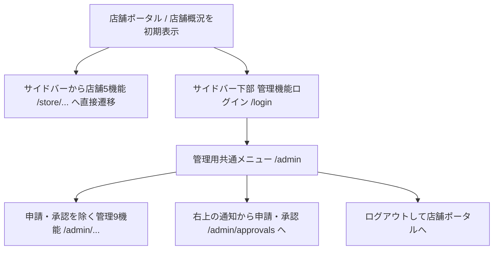

# 画面遷移図に沿ったルート構造

基準: `画面遷移図1.drawio`（01～05）、統合要件書v3第8・12・25章、ユーザーの入口認証に関する指示。FR-028/034/035、NFR-006/007/008、AT-10に対応する。

| 用途 | URL                      | 内容                   |
| ---- | ------------------------ | ---------------------- |
| 店舗 | `/store/sales-inventory` | 自店舗 売上・在庫      |
| 店舗 | `/store/orders`          | 発注入力・履歴         |
| 店舗 | `/store/operations`      | 締め・返品・売上修正   |
| 店舗 | `/store/campaigns`       | 特売内容・価格確認     |
| 店舗 | `/store/notices`         | お知らせ・特売作業依頼 |
| 管理 | `/admin/sales`           | 売上集計・店舗比較     |
| 管理 | `/admin/products`        | 商品検索・編集         |
| 管理 | `/admin/campaigns`       | 特売一覧・登録         |
| 管理 | `/admin/orders`          | 発注状況・履歴         |
| 管理 | `/admin/approvals`       | 申請・承認             |
| 管理 | `/admin/monthly`         | 月次締め・会計出力     |
| 管理 | `/admin/stores`          | 店舗設定・端末管理     |
| 管理 | `/admin/imports`         | 連携状況・再処理       |
| 管理 | `/admin/users`           | 利用者・権限設定       |
| 管理 | `/admin/audit`           | 監査ログ検索・詳細     |

店舗の `/store/sales-inventory` は、登録済み店舗端末がある場合はその店舗を優先し、ない場合はログイン利用者の担当店舗に対象を固定する。店舗名・店舗選択欄は表示せず、売上は営業日の開始日・終了日、在庫は品目コード・品目名・分類・商品名で絞り込む。売上の日付行から明細を開き、端末登録トークンまたはログイン利用者の店舗権限で同一店舗の日別明細を取得する。売上データは日別集計のため、時刻単位ではなく営業日単位の検索とする。

`/store/operations` の後日修正依頼は `/admin` と `/admin/approvals` の個人宛通知から開く。`?correction=<UUID>` で対象依頼・承認履歴に絞り込む。エリア一次承認→本部最終承認を行い、結果を `/store/notices` の店舗お知らせ・個人宛通知に表示する。

サイドバーの「店舗用共通メニュー」は削除する。`/store` は既存URLとの互換用に残す。未接続時は店舗5機能と管理10機能に操作プレビューを表示し、ログイン画面のプレビューリンクから管理画面へ入れる。接続済み管理画面の認証・権限制御は継続する。

`/admin/campaigns` で商品本部が特売・価格変更の作業指示を発行し、対象店舗の `/store/notices` に作業依頼として表示する。`/store/campaigns` は特売内容・進捗の参照画面とし、お知らせ用の依頼カードは重複表示しない。公開済み特売も店舗のお知らせに通知する。未接続プレビューでは同じタブ内で本部発行・対象店舗切替・確認を試せる。

旧 `/sales` `/campaigns` `/approvals` `/stores` `/imports` は対応する `/admin/...` へリダイレクトする。`/login?next=/admin/...` は既知の管理ルートだけを戻り先に許可し、ログアウトは `/` へ戻る。

店舗ルートの公開は画面の入口を指す。店舗識別・担当範囲の信頼できる設定が未実装のため、現時点では実データも金額操作も公開しない。店舗所属や権限をURL・localStorageで代替しない。金額操作は個人識別とRPC/RLSによる認可が必要。

管理メニューの利用可否は図03の緑色セルに対応する既存ロールを `access-policy.ts` で定義する。複数ロールは利用可能な入口の和集合。メニュー利用権限で価格変更・承認権限を代替せず、既存RPC/RLSの制約を維持する。独立ロールがない経営閲覧者/商品本部長はAUTH-02として保留し、権限を自動付与しない。

認可は各管理ページのデータ取得前に `requireAdminFeature` で確認する（layoutだけに依存しない）。未ログインはログインへ、権限不足は404として業務内容を返さない。Supabase未設定では管理機能の設定案内を表示し、業務処理は実行しない。API/Server Actionも別途認可し、DBのRLSは維持する。

管理10機能と店舗5機能のルート存在は、業務機能の完成を意味しない。実装状況と未接続画面は `requirements-v3-audit.md` に記載する。

管理トップ `/admin` は申請・承認を除く管理9機能を説明付きで初期表示し、ログイン利用者のロールで利用できる機能だけをリンクにする。権限のない機能は「権限なし」と表示して遷移させない。申請・承認は管理画面共通の右上に置く通知ボタンから対象通知を開いて行い、管理トップに重複するボタンを置かない。通知ボタンを押すと個人宛の通知一覧をダイアログ表示する（FR-028/029、AT-10）。未読件数をボタンに表示し、閉じる・Escで終了してボタンにフォーカスを戻す。通知取得失敗は一覧内で案内する。未接続では通知を取得せず接続案内を表示する。

特売の変更依頼: `/admin/campaigns` で期間・商品・特売価格・対象店舗を下書き保存し、商品明細で既存マスタの特売対象区分を反映する。「店舗へ変更依頼を送る」で期間/商品/価格/店舗を確認して送信すると、対象店舗の `/store/notices` に商品単位のPOS・商品値札変更依頼が届く。依頼に開始/終了日時と価格を記載し、店舗担当者はお知らせ内で「POSの価格変更」「商品値札の変更」を個別に完了登録する。店舗端末参照では既存のお知らせ表示を利用する。
